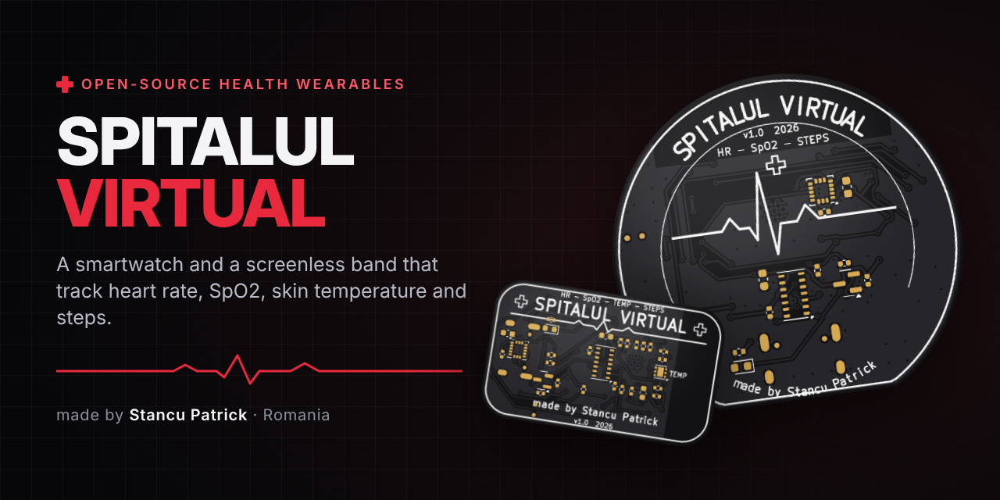
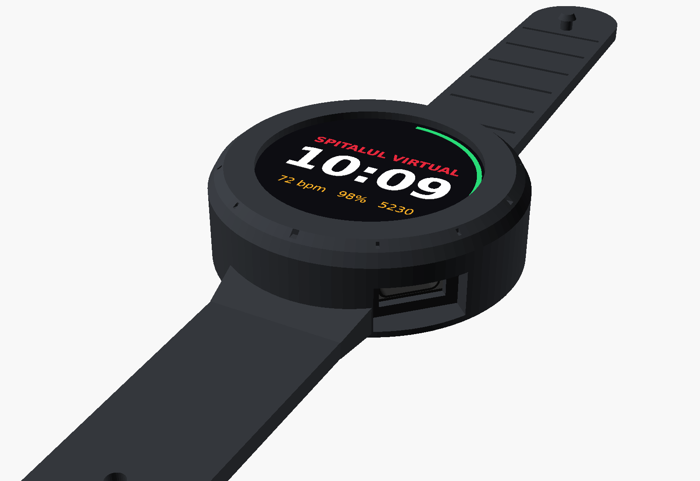
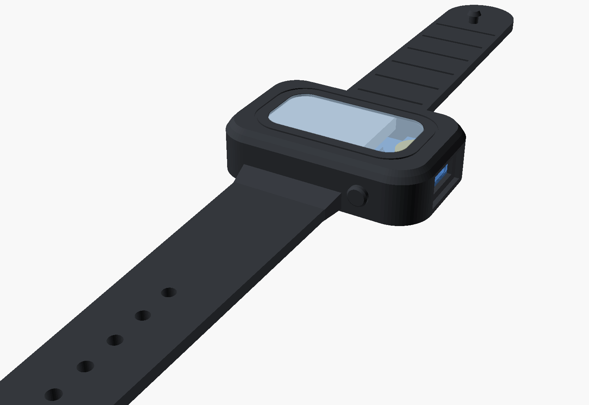
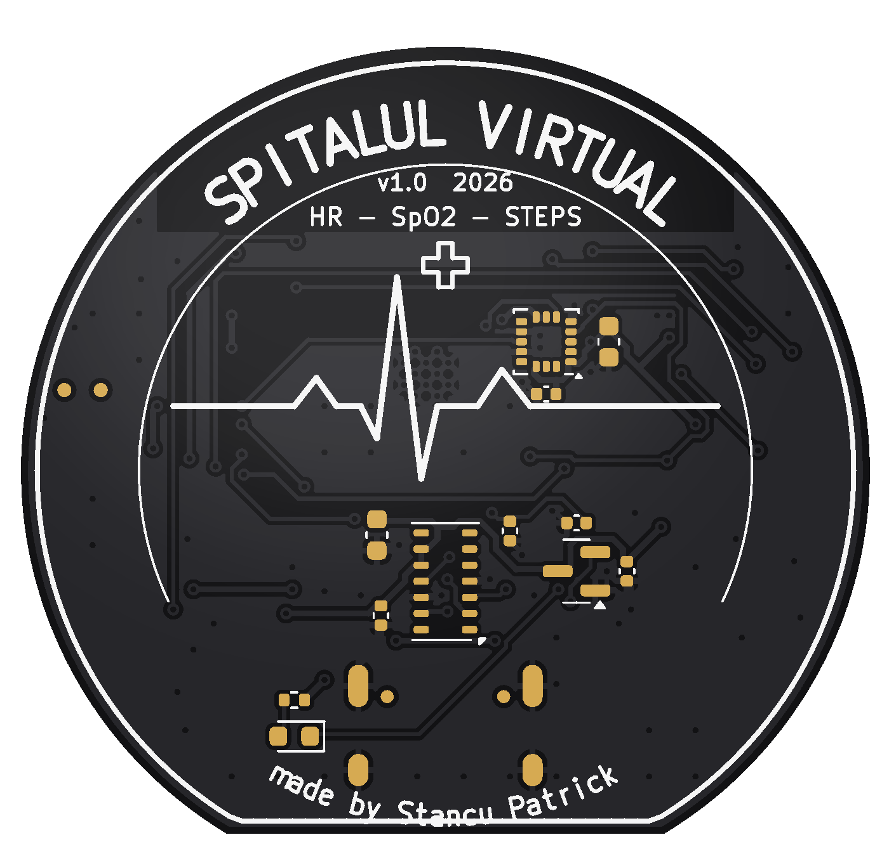
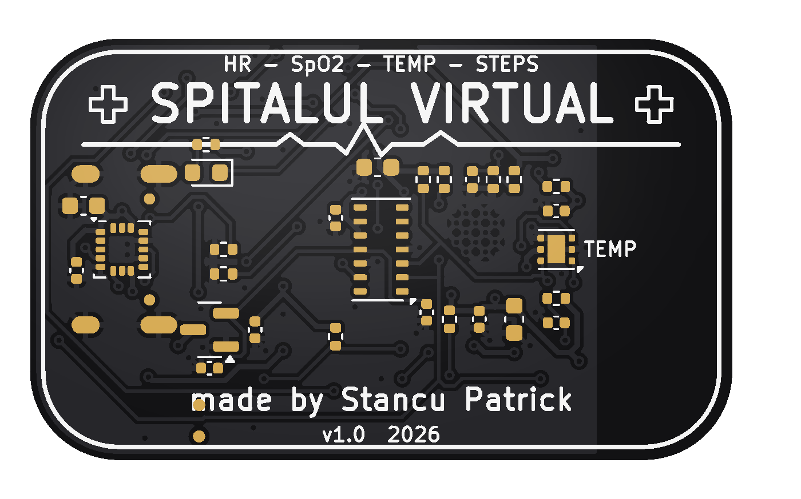
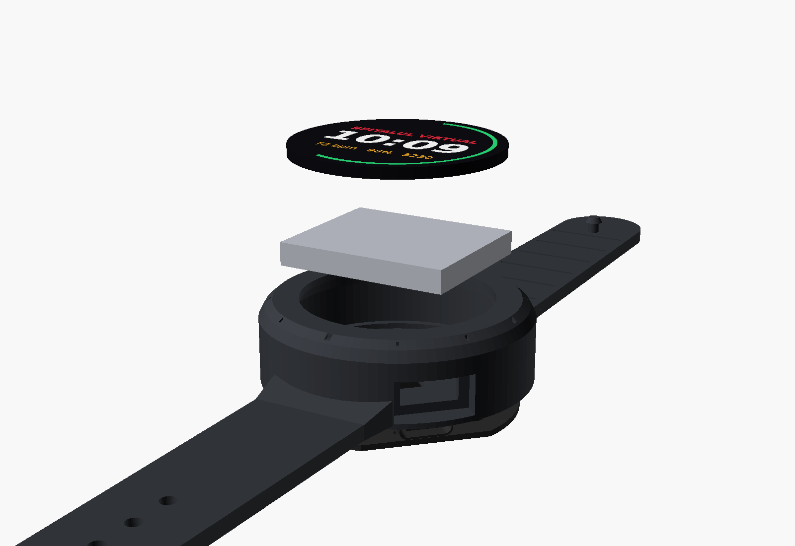
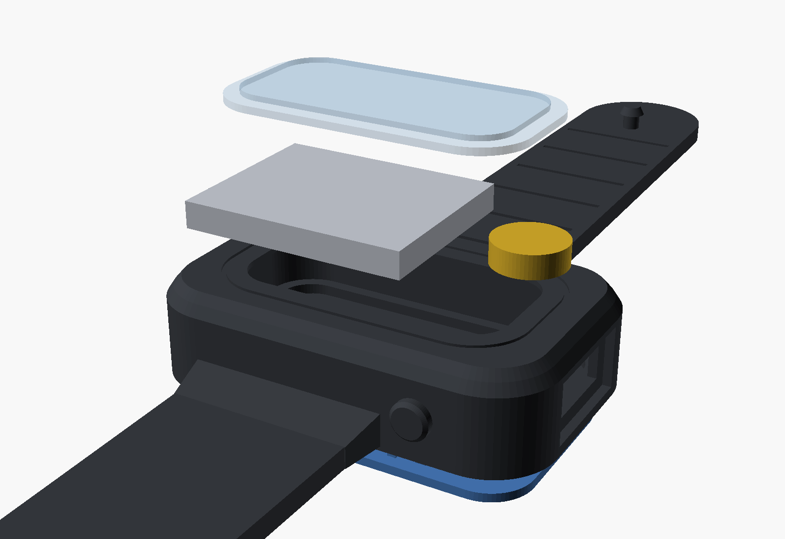

<p align="center">
  
</p>

<p align="center">
  
  
  
  
  
</p>

<p align="center">
  🌐 <b><a href="https://stancupatrick1.github.io/spitalul-virtual/">stancupatrick1.github.io/spitalul-virtual</a></b> – website, sign-up and live dashboard
</p>

<p align="center">
  <b>Spitalul Virtual</b> (“The Virtual Hospital”) is an open-source health wearable platform.<br>
  It comes in two versions – a <b>smartwatch</b> with a round screen and a slim, <b>screenless band</b> – both built from scratch:<br>
  custom black PCB, silicone case with straps, firmware and a phone web app.
</p>

---

## ✨ Two devices, one platform

<table>
  <tr>
    <th width="50%">⌚ Spitalul Virtual Watch</th>
    <th width="50%">📿 Spitalul Virtual Band</th>
  </tr>
  <tr>
    <td></td>
    <td></td>
  </tr>
  <tr>
    <td>
      <ul>
        <li>1.28" round colour display (GC9A01)</li>
        <li>Heart rate + blood oxygen (MAX30102)</li>
        <li>Step counter (LIS3DH)</li>
        <li>Ø 42 mm round black PCB</li>
        <li>Pod Ø 46.8 × 14 mm, ~250 mAh</li>
      </ul>
    </td>
    <td>
      <ul>
        <li>No screen – LED, vibration and phone app</li>
        <li>Heart rate + SpO2 + <b>skin temperature (TMP117, ±0.1 °C)</b></li>
        <li>Step counter (LIS3DH)</li>
        <li>40 × 24 mm black PCB</li>
        <li>Pod 44 × 28 × 11 mm, ~110 mAh</li>
      </ul>
    </td>
  </tr>
  <tr>
    <td align="center"><a href="watch/"><b>→ watch/</b></a></td>
    <td align="center"><a href="band/"><b>→ band/</b></a></td>
  </tr>
</table>

Both run on an **ESP32-C3** (WiFi + Bluetooth LE), charge over **USB-C** and stream their data to your phone over Bluetooth using the standard Heart Rate, Pulse Oximeter and Health Thermometer services.

## 📱 All-day data in Health Connect (Android) – 🚧 in development

> **🚧 În dezvoltare / In development** – not ready for users yet (not tested on a real band, ROOK upload not connected yet).

The band saves **one record per minute, all day** (the last ~40–45 days). The **[Spitalul Virtual Android app](companion/)** downloads it over Bluetooth and writes it to **Health Connect**. From there the Spitalul Virtual platform imports it through ROOK, like data from any other watch.

```
band ──Bluetooth──▶ Spitalul Virtual app ──▶ Health Connect ──ROOK──▶ Spitalul Virtual platform
```

Test build: **[app-latest](https://github.com/stancupatrick1/spitalul-virtual/releases/tag/app-latest)** (built automatically by GitHub Actions) · step-by-step instructions (RO): [`companion/README.md`](companion/README.md) · protocol: [`band/docs/SYNC_PROTOCOL.md`](band/docs/SYNC_PROTOCOL.md)

## 🔬 The boards

| Watch – skin side | Band – skin side |
|:---:|:---:|
|  |  |

* 2 layers, 1.0 mm, **black solder mask**, white silkscreen, ENIG (gold) pads
* sensors on the skin side, battery side under the cells
* KiCad design-rule check: **0 errors, 0 unconnected pads**
* ready-to-order files for JLCPCB / PCBWay: Gerbers, BOM with LCSC part numbers, pick-and-place

## 🧩 What's inside

```
spitalul-virtual/
├── watch/                    ⌚ smartwatch with a round screen
│   ├── hardware/kicad/       KiCad 7 project (schematic, PCB, footprints, 3D models)
│   ├── hardware/jlcpcb/      Gerbers, BOM, CPL – ready to order
│   ├── mechanical/           silicone case + straps (OpenSCAD, STL), mold, PCB STEP
│   ├── firmware/             ESP32-C3 firmware (PlatformIO / Arduino)
│   └── docs/                 schematic PDF, ordering guide, build guide
└── band/                     📿 slim screenless band
    ├── hardware/  mechanical/  firmware/  docs/   (same layout)
    └── app/                  web app – live data over Web Bluetooth
companion/                    📱 Android app (Flutter): band → Health Connect
```

Every design file is generated from one Python description of the circuit (`*/scripts/design.py`), so the schematic and the PCB always match – run `scripts/make_all.sh` to rebuild a board from scratch.

## 🚀 Build one

1. **Order the PCB** – follow [`watch/docs/ORDERING_JLCPCB.md`](watch/docs/ORDERING_JLCPCB.md) or [`band/docs/ORDERING_JLCPCB.md`](band/docs/ORDERING_JLCPCB.md)
2. **Print or cast the case** – `mechanical/stl/` (TPU 85A–95A or platinum silicone)
3. **Flash the firmware** – `cd firmware && pio run -t upload`
4. **Open the app** – `band/app/index.html` in Chrome, tap *Conectează brățara*

| | |
|:---:|:---:|
|  |  |

## 🗺️ Roadmap

- [x] Schematic + PCB for the watch and the band
- [x] Silicone case, straps and casting molds
- [x] Firmware (heart rate, SpO2, steps, temperature, BLE) and web app
- [ ] First prototype boards
- [ ] Testing on the wrist and calibration
- [x] All-day history on the band + Android app that saves it to Health Connect
- [ ] Test the full path on the Spitalul Virtual platform (ROOK → „Preia din dispozitive”)

## 👋 About us

### Hi, I'm Patrick

I'm **Stancu Patrick**, a middle-school student at **Colegiul Național „Mihai Viteazul” Ploiești**, Romania, who loves building electronics that help people.

| Year | Olimpiada Națională de Creativitate Științifică | Project |
|:---:|:---|:---|
| 🥇 2024 | **Winner** | **SmartBuoy** |
| 🏅 2025 | **Mențiune** (Honourable Mention) | [**ThermoGuard**](https://github.com/stancupatrick1/thermoguard) – ESP32 temperature monitoring for medical fridges and freezers |
| 🔧 2026 | building now | **Spitalul Virtual** – this project |

More of my projects: [ThermoGuard](https://github.com/stancupatrick1/thermoguard) · [PEEPER](https://github.com/stancupatrick1/Project_Peeper) · [my GitHub profile](https://github.com/stancupatrick1)

### Hi, I'm Nicola 👋

I'm a middle-school student at **Colegiul Național „Mihai Viteazul” Ploiești**, Romania. I love learning new things and getting better at them, and right now that means building electronics that help people.

* 🔧 Working on [Spitalul Virtual](https://github.com/stancupatrick1/spitalul-virtual) with my team: improving our open-source health wearables (a smartwatch and a screenless band) and building the phone app that sends their data to a doctor
* 🇷🇴 Based in Ploiești, Romania · I write in English and Romanian

[Nicola's GitHub profile](https://github.com/NicolaGrigore2012)

## ⚠️ Disclaimer

This is a student/hobby project. Heart-rate, SpO2 and temperature readings are estimates and are **not** for medical use or diagnosis.

## 📄 License

[MIT](LICENSE) © 2026 Stancu Patrick – use it, learn from it, build your own.

<p align="center"><sub>made with ❤️ in Romania by Stancu Patrick</sub></p>
