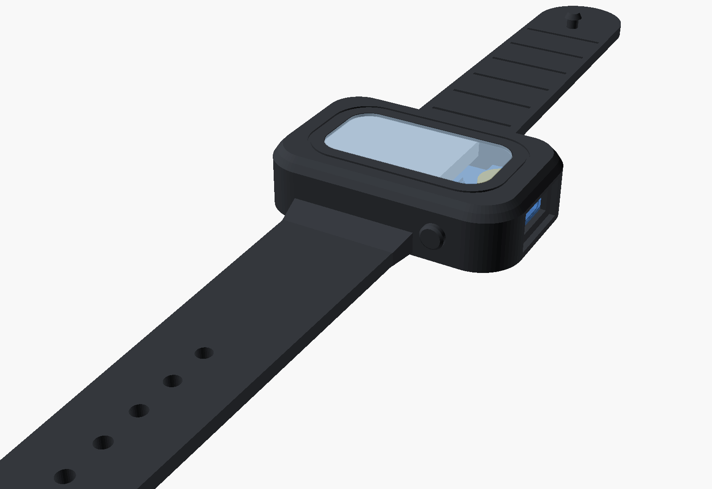
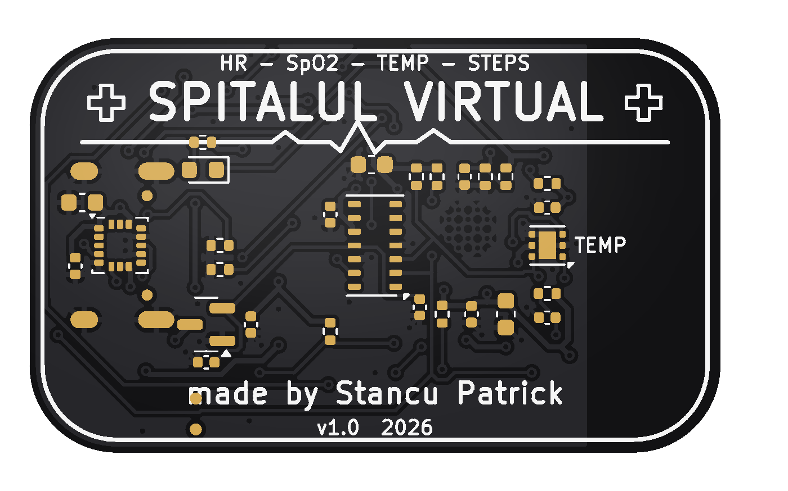
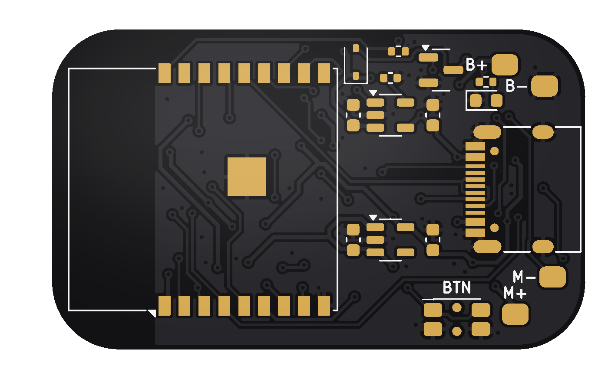

# Spitalul Virtual – Band

**made by Stancu Patrick**

A slim, **screenless** wearable, the little sibling of the Spitalul Virtual smartwatch. It has the same **black PCB** style and the same brains, plus a **skin temperature sensor**:

* ❤️ **heart rate** + 🩸 **blood oxygen (SpO2)** – MAX30102
* 🌡️ **skin temperature** (±0.1 °C) – TMP117
* 👣 **steps** – LIS3DH accelerometer
* 🔋 **USB-C charging**, 📳 vibration motor, 🟢 status LED, side button
* 📱 everything streams to your phone over **Bluetooth LE** (web app included)



| Board – skin side | Board – battery side |
|---|---|
|  |  |

> ⚠️ Hobby project. Heart-rate, SpO2 and temperature values are estimates and are **not** for medical use. The temperature is **skin** temperature (normally 32–35 °C), not body temperature.

---

## Size

| | Watch | **Band** |
|---|---|---|
| Board | Ø 42 mm round | **40 × 24 mm** pill |
| Pod | Ø 46.8 × 14 mm | **44.4 × 28.4 × 11 mm** |
| Screen | 1.28" round | none – LED + vibration + phone app |
| Battery | 402530 (~250 mAh) | 302025 (~110 mAh) |

## What's inside

| Function | Part | LCSC |
|---|---|---|
| Brain, WiFi + Bluetooth LE, USB programming | ESP32-C3-WROOM-02-N4 | C2934560 |
| Heart rate + SpO2 (skin side) | MAX30102EFD+T | C6454833 |
| Skin temperature (skin side, I2C 0x48) | TMP117AIDRVR | C699536 |
| Steps (I2C 0x19) | LIS3DHTR | C15134 |
| Li-Po charger (~210 mA) | MCP73831T-2ACI/OT | C424093 |
| 3.3 V / 1.8 V regulators | ME6211C33M5G-N / XC6206P182MR | C82942 / C347373 |
| USB-C | HRO TYPE-C-31-M-12 | C165948 |
| Side button | EVQ-P7C01P | C388883 |
| Motor driver | AO3400A + 1N4148WS | C20917 / C2128 |
| Status LED (green, top) / charge LED (red, bottom) | 0603 LEDs | C72043 / C2286 |

**Board:** 40 × 24 mm, 2 layers, 1.0 mm, black solder mask, white silkscreen, ENIG. KiCad DRC: see `hardware/kicad/drc_report.txt`.

Hand-soldered to gold pads on the top side: **Li-Po 302025** (3.7 V, with protection circuit) → `B+ B-`, and an **8 mm coin vibration motor** → `M+ M-`.

## Folders

```
hardware/kicad/      KiCad 7 project: schematic, PCB, symbols, footprints, 3D models
hardware/jlcpcb/     ready to upload: gerber zip, BOM, CPL (pick & place)
mechanical/          band (OpenSCAD source + STL), top cap, keeper loop, silicone mold, PCB STEP
firmware/            ESP32-C3 firmware (PlatformIO / Arduino)
app/                 web app (Web Bluetooth) - live HR / SpO2 / temperature / steps
docs/                schematic PDF, layer PDFs, pictures, ordering + build guide
scripts/             Python that generates the whole design (re-run make_all.sh)
```

## Order at JLCPCB

See **[docs/ORDERING_JLCPCB.md](docs/ORDERING_JLCPCB.md)**: upload `hardware/jlcpcb/spitalul_virtual_band_gerbers.zip`, choose **1.0 mm, black, ENIG**, then `spitalul_virtual_band_BOM.csv` + `spitalul_virtual_band_CPL.csv` for assembly. Parts are on **both sides** (sensors face the skin).

## Band

`mechanical/stl/band_silicone_with_straps.stl` is one piece (pod + straps). Print in **TPU 85A–95A** or cast **silicone** with the mold in `mechanical/stl/mold/`. `band_top_cap.stl` is the rigid top window – print it in **clear PETG or clear resin** so the green LED shines through. Details in **[docs/BUILD_GUIDE.md](docs/BUILD_GUIDE.md)**.

## Firmware + app

```
cd firmware && pio run -t upload      # hold the side button while plugging USB-C in the first time
```

* **Button:** tap = battery level on the LED (1–3 blinks), double tap = vibrate, hold 3 s = off (tap to wake).
* **Bluetooth:** advertises as **"Spitalul Virtual Band"** with the standard Heart Rate, Health Thermometer, Pulse Oximeter and Battery services, plus a Spitalul Virtual service.
* **App:** open `app/index.html` in Chrome (Android / Windows / Mac / Linux), or put the repo on GitHub Pages and open `https://<you>.github.io/<repo>/app/`. Tap **Conectează brățara**.

## Regenerate everything

```
cd scripts && ./make_all.sh     # KiCad 7, Python 3 (shapely, numpy, cairosvg, cadquery), OpenSCAD
```

## License

MIT – see [LICENSE](LICENSE). © 2026 Stancu Patrick.
