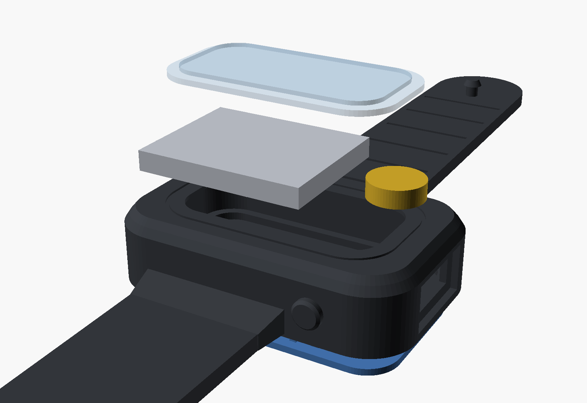

# Build guide – Spitalul Virtual Band

## Stack (bottom → top)

| Layer | Height |
|---|---|
| Silicone floor with windows: heart-rate (4.6 × 6.6 mm), temperature (Ø 3 mm), charge LED (Ø 1.2 mm) | 0 – 0.8 mm |
| Skin-side parts, board rests on a 1.2 mm ledge | 0.8 – 2.0 mm |
| PCB 1.0 mm | 2.0 – 3.0 mm |
| ESP32 module / USB-C (3.3 mm) | to 6.3 mm |
| Li-Po 302025 on the module, coin motor on the USB-C shell | 6.4 – 9.4 mm |
| Clear top cap 0.8 mm + silicone lip 0.6 mm | to 11.0 mm |

## Wiring

| Pad (top side) | Connect |
|---|---|
| B+ / B- | Li-Po red / black – **check polarity twice** |
| M+ / M- | vibration motor red / blue |

Battery tabs point toward the USB-C end. Put a piece of kapton tape on the module shield, then stick the battery on it with thin double-sided foam. Stick the motor on top of the USB-C shell.

## Temperature sensor

The TMP117 measures the skin through the round window in the floor. For good readings:
* put a **3 mm square of thermal pad** (or a small copper disc glued with thermal epoxy) in the window so it touches both the sensor and your skin;
* the reading needs ~2 minutes on the wrist to settle;
* it is skin temperature (32–35 °C), useful for trends (sleep, fever trend, workouts) – not a clinical thermometer.

## First power-up

1. Plug USB-C in without the battery. Hold the side button while plugging in → download mode.
2. `cd firmware && pio run -t upload`, then `pio device monitor`:
   `Spitalul Virtual Band: MAX30102 OK, LIS3DH OK, TMP117 OK, battery … mV`.
3. Solder the battery. While charging the red LED (skin side) is on.
4. Open the web app (`app/index.html` in Chrome, or GitHub Pages), tap **Conectează brățara**, pick "Spitalul Virtual Band".

## Band

**TPU print:** `band_silicone_with_straps.stl`, flat on the bed, TPU 85A–95A, 0.2 mm layers, 3 walls; supports only under the window lip. Also print `band_strap_keeper.stl`.

**Silicone cast:** print `mold_bottom`, `mold_top`, `mold_core` (PLA / PETG / resin), use mold release, pour platinum silicone Shore 20–30A with black pigment through the spout, cure, demold.

**Cap:** print `band_top_cap.stl` in clear PETG or clear resin (engraved "SV" faces inside).

**Assembly:** stretch the top opening, slide the board in (sensors down, USB-C toward the end opening), add battery and motor, press the cap into its seat – the silicone lip holds it.

## Notes and limits

* Not built or tested yet – treat the first boards as a prototype.
* Board auto-routed with JLCPCB rules (0.127 mm clearance, 0.3 mm vias).
* ESP32 antenna is at the left end (away from USB-C); keep metal away from it.
* "Off" is a light sleep (a few hundred µA) because the button pin cannot wake the ESP32-C3 from deep sleep. Over weeks it drains the battery – charge before use.
* No reverse-polarity protection on B+/B- and no USB ESD diode.
