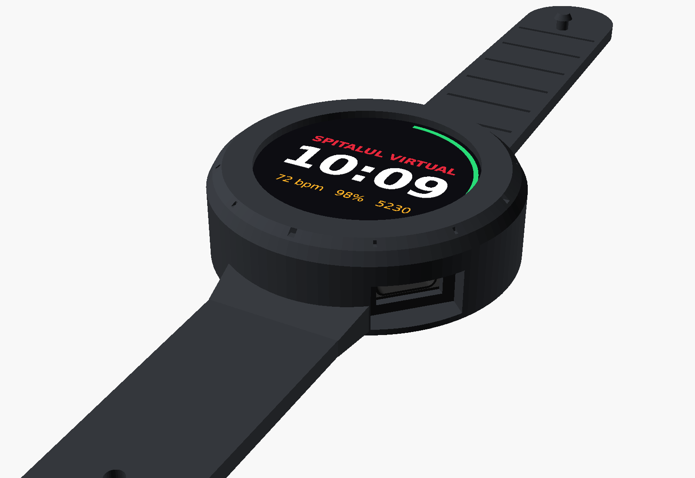
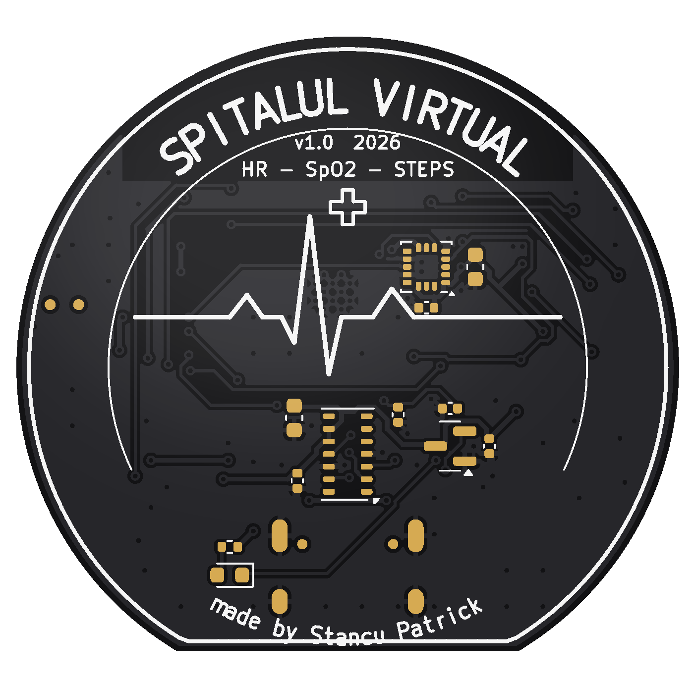
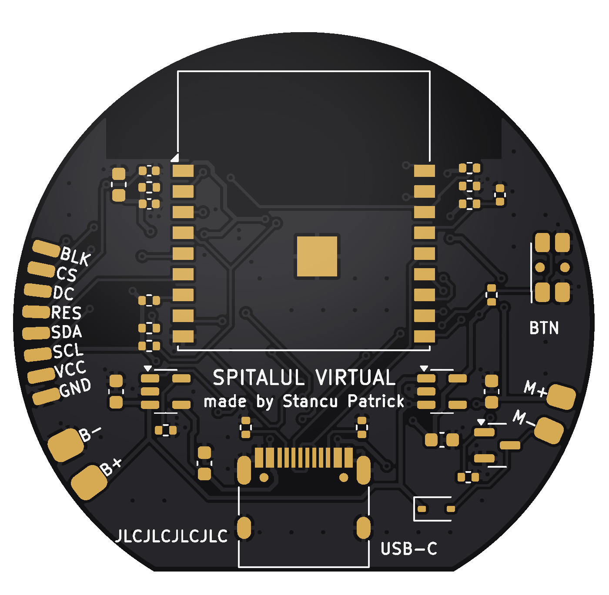

# Spitalul Virtual – smartwatch

**made by Stancu Patrick**

A round, open-source smartwatch with a **black PCB**, **heart-rate**, **blood-oxygen (SpO2)** and **step counting**, **USB-C charging**, a 1.28" round colour display and a **silicone case with built-in straps**.



| Board – wrist side | Board – battery side |
|---|---|
|  |  |

> ⚠️ Hobby project. Heart-rate and SpO2 values are estimates and are **not** for medical use.

---

## What's inside

| Function | Part | LCSC |
|---|---|---|
| Brain, WiFi + Bluetooth LE, USB programming | ESP32-C3-WROOM-02-N4 | C2934560 |
| Heart rate + SpO2 (faces the skin) | MAX30102EFD+T | C6454833 |
| Step counter (3-axis accelerometer) | LIS3DHTR | C15134 |
| Li-Po charger from USB-C (~210 mA) | MCP73831T-2ACI/OT | C424093 |
| 3.3 V regulator (500 mA) | ME6211C33M5G-N | C82942 |
| 1.8 V regulator for the sensor | XC6206P182MR | C347373 |
| USB-C connector | HRO TYPE-C-31-M-12 | C165948 |
| Side button | Panasonic EVQ-P7C01P | C388883 |
| Vibration motor driver | AO3400A + 1N4148WS | C20917, C2128 |

**Board:** 42 mm round (flat edge for USB-C), 2 layers, 1.0 mm, black solder mask, white silkscreen, ENIG.
DRC: **0 violations, 0 unconnected pads** (KiCad 7).

You also need (hand-soldered to the gold edge pads):
* **Display:** 1.28" round TFT, GC9A01 driver, 240×240, SPI – the bare panel (≤ 36 mm across, ≤ 2.2 mm thick). Pads: `GND VCC SCL SDA RES DC CS BLK`.
* **Battery:** 3.7 V Li-Po **402530** (~250 mAh, 4 × 25 × 30 mm) **with protection circuit** → pads `B+ B-`.
* **Vibration motor:** 8 mm coin motor (e.g. 0827) → pads `M+ M-` (optional).

## Folders

```
hardware/kicad/      KiCad 7 project: schematic, PCB, symbols, footprints, 3D models
hardware/jlcpcb/     ready to upload: gerber zip, BOM, CPL (pick & place)
mechanical/          silicone case + straps (OpenSCAD source, STL), mold for casting, PCB STEP
firmware/            ESP32-C3 firmware (PlatformIO / Arduino)
docs/                schematic PDF, layer PDFs, pictures, ordering + build guide
scripts/             Python that generates the whole design (re-run make_all.sh)
```

## Order the PCB at JLCPCB

Step-by-step in **[docs/ORDERING_JLCPCB.md](docs/ORDERING_JLCPCB.md)**. Short version: upload `hardware/jlcpcb/spitalul_virtual_gerbers.zip`, choose **1.0 mm, black, ENIG, 2 layers**, then for assembly upload `spitalul_virtual_BOM.csv` and `spitalul_virtual_CPL.csv`. Parts sit on **both sides** (the sensor faces the skin), so use **Standard** assembly with a JLCPCB panel – or Economic for the top side and solder the 12 bottom parts yourself.

## Case

`mechanical/stl/case_silicone_with_straps.stl` is one piece: case, straps with holes, and a peg. Print it in flexible **TPU 85A–95A**, or cast real **silicone** (Shore 20–30A) using the 3-part mold in `mechanical/stl/mold/`. Details in **[docs/BUILD_GUIDE.md](docs/BUILD_GUIDE.md)**.

Case size: Ø 46.8 mm × 14 mm. Button at 2 o'clock, USB-C at 4 o'clock, sensor window and charge-LED hole underneath, "SPITALUL VIRTUAL" / "made by Stancu Patrick" debossed on the back.

## Firmware

```
cd firmware
pio run -t upload      # hold the side button while plugging USB-C in the first time
```

Screens (short press the button to switch, long press = screen off): watch face, heart rate with live pulse wave, SpO2, steps. Bluetooth LE advertises as **"Spitalul Virtual"** with the standard Heart Rate service, so phone apps (e.g. nRF Connect) can read your pulse. Put WiFi details in `firmware/include/config.h` to set the clock over the internet.

## Regenerate everything

All files are generated from `scripts/design.py` (one list of parts + connections):

```
cd scripts && ./make_all.sh     # needs KiCad 7, Python 3, shapely, numpy, cairosvg
```

## License

MIT – see [LICENSE](LICENSE). © 2026 Stancu Patrick.
