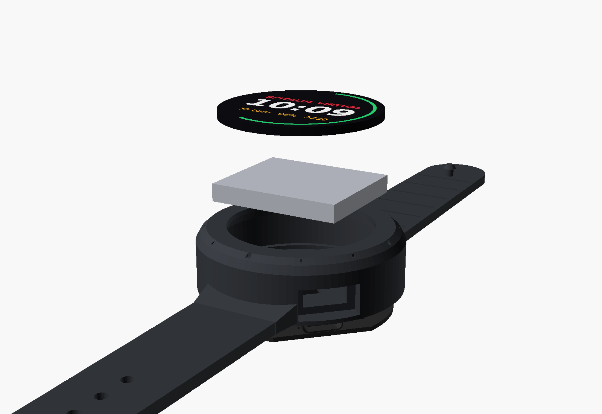
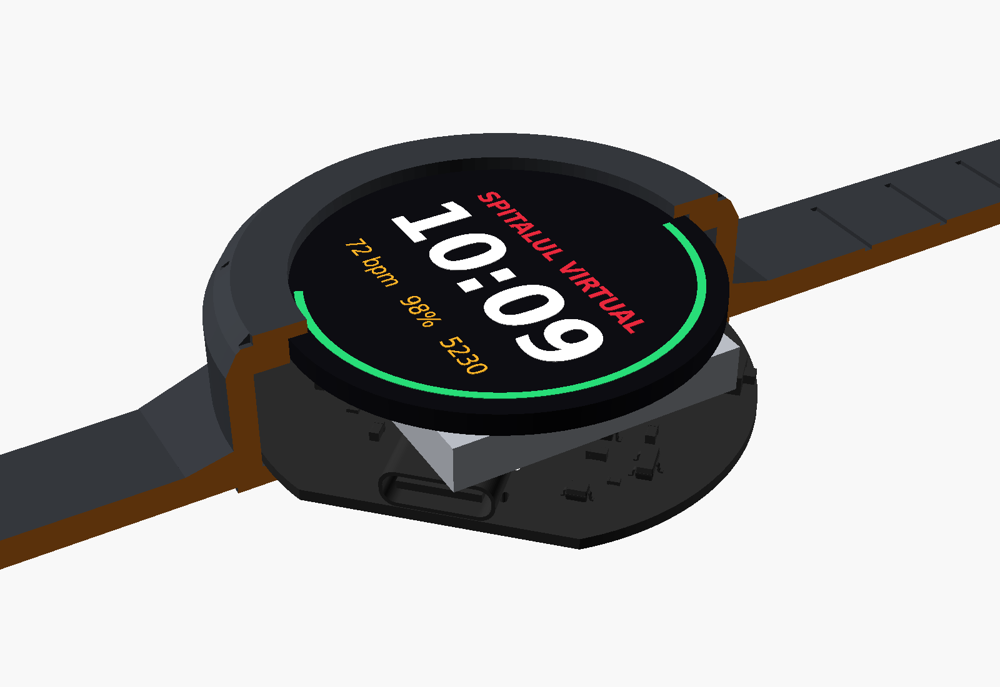

# Build guide – Spitalul Virtual smartwatch

## Stack (bottom → top)

| Layer | Height |
|---|---|
| Case floor (with sensor window + LED hole) | 0 – 0.8 mm |
| Space for skin-side parts, PCB rests on a ledge | 0.8 – 1.8 mm |
| PCB 1.0 mm | 1.8 – 2.8 mm |
| Top-side parts (ESP32 module 3.2 mm, USB-C 3.26 mm) | to 6.2 mm |
| Li-Po 402530 (4 mm) | 6.4 – 10.4 mm |
| Round display (≤ 2.2 mm) | 10.6 – 12.8 mm |
| Silicone lip over the display edge | to 14.0 mm |

## Wiring the edge pads

All edge pads are on the battery side of the board, labelled in white.

| Pad | Display (GC9A01) |
|---|---|
| GND | GND |
| VCC | VCC (3.3 V) |
| SCL | SCL / SCK |
| SDA | SDA / MOSI |
| RES | RES / RST (tied to the ESP32 reset) |
| DC | DC |
| CS | CS |
| BLK | BLK / backlight |

| Pad | Connect |
|---|---|
| B+ / B- | Li-Po red / black. **Check polarity twice.** |
| M+ / M- | vibration motor red / blue (optional) |

Use 30 AWG wire, keep it short, route the display wires around the side of the battery. A small piece of double-sided foam tape holds the battery on top of the module.

## First power-up

1. Plug USB-C in **without** the battery first. The red LED on the back may flicker (no battery) – that's normal.
2. Hold the side button, plug USB-C in → the ESP32-C3 starts in download mode.
3. `cd firmware && pio run -t upload`, then `pio device monitor`. You should see
   `Spitalul Virtual: MAX30102 OK, LIS3DH OK, battery … mV`.
4. Unplug, solder the battery, plug back in: the red LED is on while charging and off when full.

## Case

**Option 1 – 3D print (TPU).** Print `mechanical/stl/case_silicone_with_straps.stl` flat (straps on the bed) in TPU 85A–95A, 0.2 mm layers, 3 walls, 100 % infill for the straps, supports only for the display lip. Print `strap_keeper_loop.stl` too.

**Option 2 – real silicone.** Print the three mold parts in `mechanical/stl/mold/` in PLA/PETG/resin:
* `mold_bottom` – flat plate (forms the back with the debossed text),
* `mold_top` – outer shape, pour spout and two vents,
* `mold_core` – hangs from the top opening and forms the inside, sensor window, USB-C and button pocket.

Spray mold release, place top on bottom (3 alignment pins), insert the core, pour platinum silicone (Shore 20–30A, e.g. Dragon Skin 20; add black pigment) through the spout, let it cure, then stretch the opening to pull the core out.

**Fitting:** stretch the display opening and slide in the PCB (sensor down, USB-C lined up with the port at 4 o'clock), then the battery, then the display. The lip holds everything.

## Changing the case

`mechanical/case.scad` is fully parametric (OpenSCAD): display size (`DISP_D`, `DISP_T`), battery, wall thickness, strap length, hole pitch. Export with
`openscad -D 'PART="case"' -o case.stl case.scad` (parts: `case`, `keeper`, `mold_bottom`, `mold_top`, `mold_core`).
`mechanical/assembly.scad` shows the whole watch with the real PCB model.

## Notes and limits

* **Display backlight:** the `BLK` pad comes straight from an ESP32 pin (GPIO2, PWM). Breakout-style GC9A01 boards have a `BLK` input with their own transistor – perfect. A *bare* panel instead has `LEDA`/`LEDK` pins: connect `LEDK` to GND and `LEDA` to `BLK`; the pin can only give about 20–40 mA, so the screen will be a bit dimmer than on a breakout.
* Bare panels come on a thin flat cable (FPC). Use a small FPC-to-pads adapter, or a GC9A01 breakout small enough for the 36 mm recess (or change `DISP_D` in `case.scad`).
* The MAX30102 interrupt line has no pull-up on the board; the firmware polls the sensor, so it is not needed. If you use the interrupt, turn on the ESP32 internal pull-up (`pinMode(20, INPUT_PULLUP)`).
* The charger and the watch share the battery while charging, so charging may not fully "finish" while the screen is on. That is safe for the cell, just slower.
* There is no reverse-polarity protection on `B+`/`B-` and no ESD diode on USB – be careful when soldering and handling.

* Heart rate / SpO2 on the wrist are noisy; keep the strap snug and still. The values are estimates, not medical measurements.
* The board was auto-routed and passes KiCad DRC with JLCPCB rules (0.127 mm clearance, 0.3 mm vias). It has not been built and tested yet – treat the first batch as a prototype.
* The ESP32 antenna is at the 10–11 o'clock edge; keep metal away from that part of the case.
